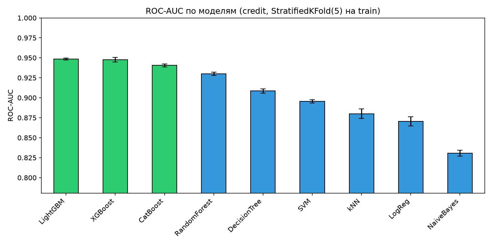
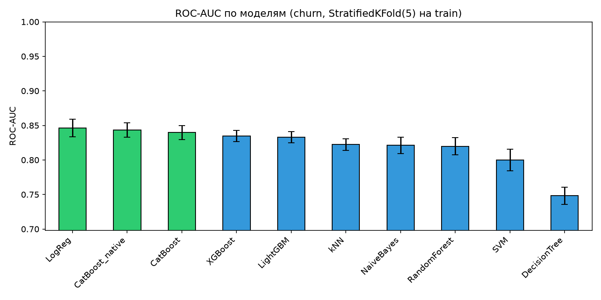
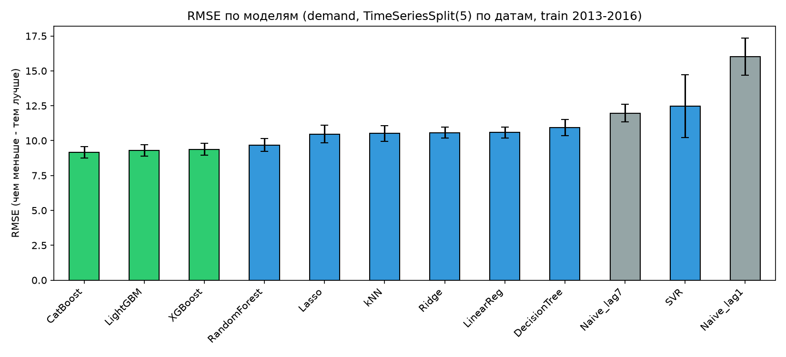
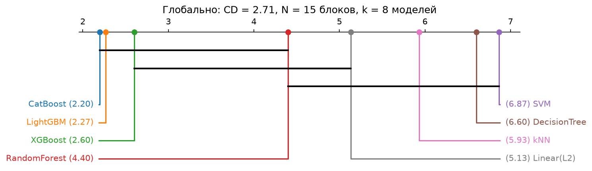
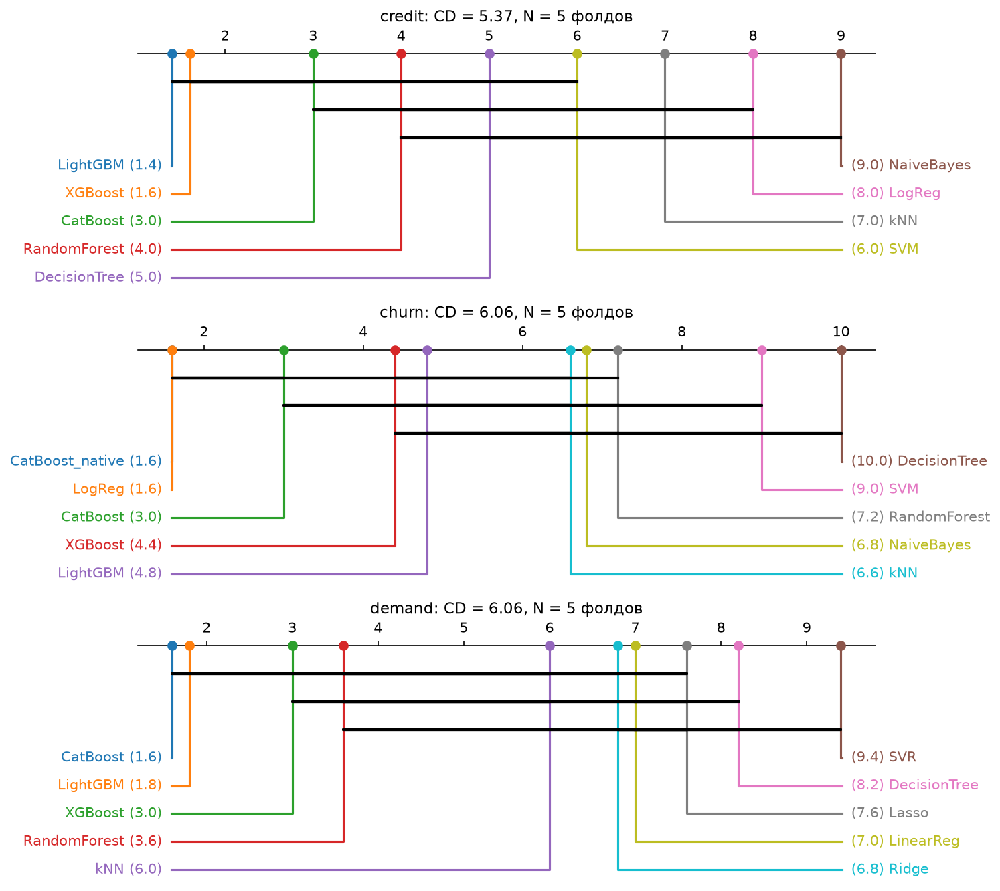
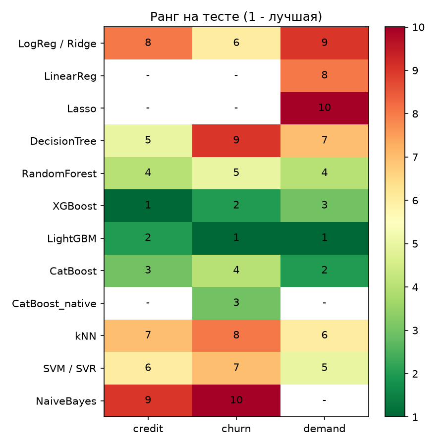

# Итоговый отчёт по результатам экспериментов

Отчёт только по тому, что получено в ноутбуках `01`-`05` (прогон «Restart & Run All», `RANDOM_STATE = 42`).
Все числа взяты из `results/*.csv`; графики - `results/*.png`.

## 1. Что и как считалось

| | credit | churn | demand |
|---|---|---|---|
| Задача | классификация (дефолт) | классификация (отток) | регрессия (продажи за день, прогноз на 1 день) |
| Строк после обработки | 32 416 | 7 043 | 53 880 (30 пар store×item из 500, весь период) |
| Train / Test | 25 932 / 6 484 (80/20, стратиф.) | 5 634 / 1 409 (80/20, стратиф.) | 42 930 (2013-2016) / 10 950 (2017) |
| Доля класса 1 | 0.2187 | 0.2654 | - |
| CV для сравнения | StratifiedKFold(5) на train | StratifiedKFold(5) на train | TimeSeriesSplit(5) по датам на train |
| Подбор гиперпараметров | RandomizedSearchCV, 3 фолда, 8-20 итераций | то же | RandomizedSearchCV, TimeSeriesSplit(3), 1-15 итераций |
| Метрики | ROC-AUC, F1 | ROC-AUC, F1 | RMSE, MAE, MAPE (по sales > 0) |

Протокол: (1) сравнение моделей с **фиксированными** гиперпараметрами кросс-валидацией на train;
(2) подбор гиперпараметров каждой модели на train; (3) **одна** оценка подобранной модели на отложенном тесте;
(4) тест Фридмана + Неменьи по метрикам на фолдах.

## 2. Обработка данных - что было найдено

**credit**
- 165 полных дубликатов строк - удалены.
- Невозможные значения: возраст 123 и 144 года (5 строк), стаж 123 года у 21-22-летних (2 строки) -> превращены в пропуски и заполнены.
- Пропуски: стаж 895, ставка 3 116. У клиентов без стажа доля дефолтов **0.315** против 0.218 в среднем -> пропуск информативен, добавлен флаг `was_missing`.
- Медиана стажа одинакова (4 года) во всех возрастных группах, но различается по типу жилья (3-5) и доходу (3-5) -> стаж заполняется медианой внутри «тип жилья × квинтиль дохода».
- Ставка заполняется медианой внутри грейда (A 7.49% ... G 20.16%); возраст - медианой внутри длины кредитной истории (корреляция 0.859).
- Все медианы считаются только на train (внутри `Pipeline`). Пример подстановок на train: стаж - 6 разных значений от 2 до 7 лет вместо одного «4»; ставка - 7 значений от 7.49 до 20.11 вместо одного «10.99».

**churn**
- 11 пустых `TotalCharges`, у всех `tenure = 0` -> по формуле `tenure × MonthlyCharges` = 0 (новые клиенты). Медиана отношения `TotalCharges / (tenure × MonthlyCharges)` = 1.000.

**demand**
- Сетка полная (500 пар × 1 826 дней), дубликатов нет; одна строка с `sales = 0`.
- В подвыборке средние продажи 61.4 шт. в 2013-2016 и 70.7 шт. в 2017.

## 3. Credit Risk

### 3.1. Кросс-валидация на train (фиксированные гиперпараметры)

| Модель | ROC-AUC | F1 | train ROC-AUC |
|---|---|---|---|
| LightGBM | 0.9486 ± 0.0013 | 0.8347 ± 0.0035 | 0.9860 |
| XGBoost | 0.9478 ± 0.0029 | 0.8350 ± 0.0026 | 0.9840 |
| CatBoost | 0.9406 ± 0.0018 | 0.8333 ± 0.0024 | 0.9627 |
| RandomForest | 0.9301 ± 0.0022 | 0.8240 ± 0.0045 | 1.0000 |
| DecisionTree | 0.9085 ± 0.0027 | 0.8169 ± 0.0041 | 0.9321 |
| SVM | 0.8956 ± 0.0020 | 0.7558 ± 0.0079 | 0.9114 |
| kNN | 0.8800 ± 0.0059 | 0.6883 ± 0.0030 | 0.9279 |
| LogReg | 0.8705 ± 0.0057 | 0.6431 ± 0.0120 | 0.8715 |
| NaiveBayes | 0.8307 ± 0.0037 | 0.5184 ± 0.0667 | 0.8311 |

### 3.2. После подбора гиперпараметров - отложенный тест

| Модель | CV ROC-AUC (дефолт) | CV ROC-AUC (подбор) | Тест ROC-AUC | Тест F1 | Precision | Recall |
|---|---|---|---|---|---|---|
| XGBoost | 0.9478 | 0.9467 | 0.9488 | 0.8389 | 0.9712 | 0.7384 |
| LightGBM | 0.9486 | 0.9469 | 0.9486 | 0.8362 | 0.9738 | 0.7327 |
| CatBoost | 0.9406 | 0.9427 | 0.9425 | 0.8399 | 0.9811 | 0.7341 |
| RandomForest | 0.9301 | 0.9332 | 0.9319 | 0.8345 | 0.9791 | 0.7271 |
| DecisionTree | 0.9085 | 0.9123 | 0.9073 | 0.7585 | 0.9060 | 0.6523 |
| SVM | 0.8956 | 0.8977 | 0.8993 | 0.7643 | 0.9240 | 0.6516 |
| kNN | 0.8800 | 0.8874 | 0.8869 | 0.6778 | 0.8957 | 0.5451 |
| LogReg | 0.8705 | 0.8706 | 0.8687 | 0.6539 | 0.7723 | 0.5670 |
| NaiveBayes | 0.8307 | 0.8322 | 0.8254 | 0.5757 | 0.5725 | 0.5790 |

**Что видно:**
- Порядок семейств одинаков на CV и тесте: бустинг > RandomForest > DecisionTree > SVM > kNN > LogReg > NaiveBayes.
  На всех 5 фолдах ранги моделей совпадают (меняются местами только XGBoost и LightGBM).
- XGBoost и LightGBM на тесте различаются на 0.0002 (стандартная ошибка ROC-AUC на этом тесте ≈ 0.004) - неразличимы.
  Отрыв бустинга от RandomForest ≈ 0.017 - больше 4 стандартных ошибок.
- Подбор гиперпараметров почти ничего не меняет (тест после подбора − CV с дефолтами: от −0.005 до +0.007).
- RandomForest запоминает train полностью (train ROC-AUC = 1.000), LogReg и NaiveBayes имеют разрыв train-валидация ≈ 0 -
  они недообучаются.
- У бустинга precision ≈ 0.97-0.98 при recall ≈ 0.73 (порог 0.5): дефолт называют почти без ошибок, но пропускают ~27% дефолтов.

## 4. Telco Churn

### 4.1. Кросс-валидация на train (фиксированные гиперпараметры)

| Модель | ROC-AUC | F1 | train ROC-AUC |
|---|---|---|---|
| LogReg | 0.8462 ± 0.0126 | 0.5923 ± 0.0299 | 0.8496 |
| CatBoost_native | 0.8434 ± 0.0103 | 0.5799 ± 0.0195 | 0.8987 |
| CatBoost | 0.8397 ± 0.0101 | 0.5692 ± 0.0201 | 0.9481 |
| XGBoost | 0.8347 ± 0.0082 | 0.5705 ± 0.0219 | 0.9757 |
| LightGBM | 0.8331 ± 0.0080 | 0.5652 ± 0.0282 | 0.9746 |
| kNN | 0.8224 ± 0.0084 | 0.5780 ± 0.0158 | 0.8652 |
| NaiveBayes | 0.8212 ± 0.0119 | 0.5974 ± 0.0093 | 0.8218 |
| RandomForest | 0.8199 ± 0.0126 | 0.5374 ± 0.0278 | 0.9999 |
| SVM | 0.7998 ± 0.0158 | 0.5735 ± 0.0162 | 0.8655 |
| DecisionTree | 0.7482 ± 0.0126 | 0.5293 ± 0.0151 | 0.9554 |

### 4.2. После подбора гиперпараметров - отложенный тест

| Модель | CV ROC-AUC (дефолт) | CV ROC-AUC (подбор) | Тест ROC-AUC | Тест F1 | Precision | Recall |
|---|---|---|---|---|---|---|
| LightGBM | 0.8331 | 0.8496 | 0.8493 | 0.5655 | 0.7024 | 0.4733 |
| XGBoost | 0.8347 | 0.8489 | 0.8482 | 0.5745 | 0.6751 | 0.5000 |
| CatBoost_native | 0.8434 | 0.8497 | 0.8459 | 0.5898 | 0.6701 | 0.5267 |
| CatBoost | 0.8397 | 0.8486 | 0.8455 | 0.5736 | 0.6827 | 0.4947 |
| RandomForest | 0.8199 | 0.8468 | 0.8423 | 0.5740 | 0.6690 | 0.5027 |
| LogReg | 0.8462 | 0.8461 | 0.8409 | 0.5945 | 0.6458 | 0.5508 |
| SVM | 0.7998 | 0.8368 | 0.8320 | 0.5552 | 0.6511 | 0.4840 |
| kNN | 0.8224 | 0.8341 | 0.8317 | 0.5884 | 0.5940 | 0.5829 |
| DecisionTree | 0.7482 | 0.8374 | 0.8317 | 0.5495 | 0.6654 | 0.4679 |
| NaiveBayes | 0.8212 | 0.8210 | 0.8077 | 0.5928 | 0.4589 | 0.8369 |

**Что видно:**
- С фиксированными гиперпараметрами LogReg первая (0.8462), бустинг ниже (0.833-0.840): у бустинга разрыв train-валидация
  ≈ 0.11-0.14, у RandomForest 0.18, у DecisionTree 0.21 - на 5.6 тыс. строк они переобучаются.
- После подбора (бустинг выбрал `learning_rate` ≈ 0.01 и ≈ 210-220 деревьев) первые 6 моделей на тесте лежат в
  диапазоне 0.841-0.849. Стандартная ошибка ROC-AUC на тесте из 1 409 клиентов ≈ 0.013 -> лидеры **неразличимы**.
- Прирост CV ROC-AUC от подбора: DecisionTree +0.089, SVM +0.037, RandomForest +0.027, LightGBM +0.017, XGBoost +0.014, CatBoost +0.009, LogReg 0.000.
- CatBoost с нативными категориями vs OneHot: 0.8434 vs 0.8397 на CV, 0.8459 vs 0.8455 на тесте - разница в пределах шума.
- F1 у всех 0.55-0.59 (recall ≈ 0.47-0.58 при пороге 0.5). NaiveBayes: recall 0.84, precision 0.46 -> F1 0.593 (2-й) при худшем ROC-AUC.

## 5. Store Item Demand

### 5.1. Кросс-валидация на train (фиксированные гиперпараметры)

| Модель | RMSE | MAE | MAPE | train RMSE |
|---|---|---|---|---|
| CatBoost | 9.1721 ± 0.4139 | 7.0834 ± 0.3189 | 0.1340 ± 0.0143 | 8.0776 |
| LightGBM | 9.2986 ± 0.4153 | 7.1656 ± 0.3161 | 0.1345 ± 0.0170 | 7.3135 |
| XGBoost | 9.3789 ± 0.4292 | 7.2185 ± 0.3246 | 0.1353 ± 0.0183 | 6.6897 |
| RandomForest | 9.6827 ± 0.4597 | 7.4780 ± 0.3593 | 0.1421 ± 0.0150 | 3.3499 |
| Lasso | 10.4693 ± 0.6264 | 8.0965 ± 0.4957 | 0.1552 ± 0.0119 | 9.7797 |
| kNN | 10.5109 ± 0.5682 | 8.1372 ± 0.4077 | 0.1537 ± 0.0185 | 8.4554 |
| Ridge | 10.5756 ± 0.3986 | 8.1790 ± 0.3013 | 0.1574 ± 0.0204 | 9.5380 |
| LinearReg | 10.5866 ± 0.3950 | 8.1878 ± 0.2985 | 0.1576 ± 0.0208 | 9.5379 |
| DecisionTree | 10.9431 ± 0.5892 | 8.3432 ± 0.3842 | 0.1575 ± 0.0190 | 8.0900 |
| Naive_lag7 | 11.9737 ± 0.6448 | 9.2164 ± 0.5286 | 0.1729 ± 0.0123 | 11.2471 |
| SVR | 12.4634 ± 2.2537 | 9.2916 ± 1.4002 | 0.1813 ± 0.0255 | 8.6466 |
| Naive_lag1 | 16.0146 ± 1.3374 | 11.8190 ± 0.9252 | 0.2207 ± 0.0095 | 14.8713 |

### 5.2. После подбора гиперпараметров - тест 2017

| Модель | CV RMSE (дефолт) | Тест RMSE | Тест MAE | Тест MAPE |
|---|---|---|---|---|
| LightGBM | 9.2986 | 9.4158 | 7.2651 | 0.1193 |
| CatBoost | 9.1721 | 9.4408 | 7.2627 | 0.1194 |
| XGBoost | 9.3789 | 9.5125 | 7.3373 | 0.1206 |
| RandomForest | 9.6827 | 9.9175 | 7.6279 | 0.1238 |
| SVR | 12.4634 | 10.4968 | 8.0109 | 0.1287 |
| kNN | 10.5109 | 10.5849 | 8.1819 | 0.1368 |
| DecisionTree | 10.9431 | 10.8792 | 8.3456 | 0.1361 |
| LinearReg | 10.5866 | 11.2018 | 8.6330 | 0.1447 |
| Ridge | 10.5756 | 11.2524 | 8.6718 | 0.1453 |
| Lasso | 10.4693 | 11.3930 | 8.7517 | 0.1452 |
| Naive_lag7 | 11.9737 | 12.9023 | 9.8440 | 0.1600 |
| Naive_lag1 | 16.0146 | 17.4137 | 12.7938 | 0.2095 |

**Что видно:**
- Лучшие на тесте - LightGBM (RMSE 9.42, MAE 7.27, MAPE 11.9%), CatBoost (9.44) и XGBoost (9.51).
  Сезонный наивный прогноз («как неделю назад») - 12.90: бустинг лучше него на 27%, линейные модели - на 12-13%.
- Naive_lag7 намного лучше Naive_lag1 (11.97 против 16.01 на CV): недельная сезонность сильнее, чем связь с «вчера».
- CatBoost и LightGBM лучше всех линейных моделей в каждом из 5 фолдов.
- RMSE/MAE ≈ 1.29-1.30 у бустинга, леса и линейных (≈ 1.25 для нормальных ошибок) - крупных выбросов в ошибках нет.
- На тесте RMSE выше, а MAPE ниже, чем на CV (LightGBM: 9.42 против 9.30 и 11.9% против 13.4%) - продажи в 2017 выше на ~15%.
- SVR с `C = 1` хуже наивного прогноза (CV 12.46); после подбора (`C ≈ 2.7`, `epsilon = 3`, `gamma = 0.01`) - 10.50 на тесте.
- Ridge после подбора (`alpha ≈ 506`) чуть хуже LinearReg на тесте (11.25 против 11.20): подбор на 3 временных фолдах ошибся.

## 6. Статистическая значимость (Friedman + Nemenyi, α = 0.05)

| Уровень | N блоков | k моделей | p (Friedman) | CD | Значимых пар |
|---|---|---|---|---|---|
| credit (фолды) | 5 | 9 | 3.7·10⁻⁶ | 5.37 | 7 из 36 |
| churn (фолды) | 5 | 10 | 3.6·10⁻⁶ | 6.06 | 5 из 45 |
| demand (фолды) | 5 | 10 | 1.7·10⁻⁵ | 6.06 | 5 из 45 |
| глобально (датасет × фолд) | 15 | 8 | 9.9·10⁻¹² | 2.71 | 11 из 28 |
| Демшар (блок = датасет) | 3 | 8 | 0.062 | 6.06 | 0 из 28 |

**Глобальные средние ранги** (8 общих моделей, 15 блоков): CatBoost 2.20, LightGBM 2.27, XGBoost 2.60, RandomForest 4.40,
Linear(L2) 5.13, kNN 5.93, DecisionTree 6.60, SVM 6.87.

- Значимо (Неменьи): CatBoost и LightGBM лучше Linear(L2), kNN, DecisionTree, SVM; XGBoost лучше kNN, DecisionTree, SVM.
- Три бустинга между собой неразличимы; RandomForest не отличается значимо ни от бустинга, ни от линейных.
- По датасетам: credit - LightGBM и XGBoost лучше kNN, LogReg, NaiveBayes, CatBoost лучше NaiveBayes;
  churn - CatBoost-native и LogReg лучше SVM и DecisionTree, CatBoost лучше DecisionTree;
  demand - CatBoost и LightGBM лучше DecisionTree и SVR, XGBoost лучше SVR.
- На уровне «блок = датасет» (N = 3) значимых пар нет: CD = 6.06 при максимальной разнице рангов 7. Iman-Davenport при этом
  даёт p = 0.021, а χ²-Фридман - p = 0.062.

## 7. Сводная таблица «метод × датасет × метрика» (тест, после подбора)

| Модель | credit ROC-AUC | credit F1 | churn ROC-AUC | churn F1 | demand RMSE | demand MAE | demand MAPE |
|---|---|---|---|---|---|---|---|
| LogReg / Ridge | 0.8687 | 0.6539 | 0.8409 | 0.5945 | 11.2524 | 8.6718 | 0.1453 |
| LinearReg | - | - | - | - | 11.2018 | 8.6330 | 0.1447 |
| Lasso | - | - | - | - | 11.3930 | 8.7517 | 0.1452 |
| DecisionTree | 0.9073 | 0.7585 | 0.8317 | 0.5495 | 10.8792 | 8.3456 | 0.1361 |
| RandomForest | 0.9319 | 0.8345 | 0.8423 | 0.5740 | 9.9175 | 7.6279 | 0.1238 |
| XGBoost | 0.9488 | 0.8389 | 0.8482 | 0.5745 | 9.5125 | 7.3373 | 0.1206 |
| LightGBM | 0.9486 | 0.8362 | 0.8493 | 0.5655 | 9.4158 | 7.2651 | 0.1193 |
| CatBoost | 0.9425 | 0.8399 | 0.8455 | 0.5736 | 9.4408 | 7.2627 | 0.1194 |
| CatBoost_native | - | - | 0.8459 | 0.5898 | - | - | - |
| kNN | 0.8869 | 0.6778 | 0.8317 | 0.5884 | 10.5849 | 8.1819 | 0.1368 |
| SVM / SVR | 0.8993 | 0.7643 | 0.8320 | 0.5552 | 10.4968 | 8.0109 | 0.1287 |
| NaiveBayes | 0.8254 | 0.5757 | 0.8077 | 0.5928 | - | - | - |
| Naive_lag1 | - | - | - | - | 17.4137 | 12.7938 | 0.2095 |
| Naive_lag7 | - | - | - | - | 12.9023 | 9.8440 | 0.1600 |

Полная версия с CV (mean ± std) - `results/final_table.csv` и `results/final_table_long.csv`.

## 8. Выводы по данным

1. **Бустинг (XGBoost, LightGBM, CatBoost) - лучший или в группе лучших на всех трёх датасетах**; три реализации между собой неразличимы.
2. **Преимущество бустинга зависит от данных:** +0.080 ROC-AUC над LogReg на credit (32 тыс. строк, числовые признаки),
   +0.008 на churn (7 тыс. строк, 15 категориальных) - в пределах шума, −16% RMSE относительно линейной регрессии на demand.
3. **На малых данных подбор гиперпараметров решает:** без него бустинг на churn уступал LogReg, с ним - сравнялся.
   LogReg от подбора не меняется - это её практическое преимущество.
4. **Одиночное дерево и SVM - нижняя группа** по глобальным рангам; NaiveBayes - последняя по ROC-AUC на тесте credit и churn.
5. **Во временном ряду обязательно сравнение с наивным прогнозом:** без подбора SVR оказался хуже прогноза «как неделю назад».
6. **С тремя датасетами строгого статистического вывода сделать нельзя** - значимость получена на фолдах CV, которые зависимы.

## 9. Ограничения

- 3 датасета; p-value на фолдах оптимистичны (фолды зависимы).
- Бюджет подбора: 6-20 итераций RandomizedSearchCV на модель (2 ядра CPU).
- Порог классификации не подбирался (F1 при пороге 0.5).
- Demand: 30 пар из 500, горизонт 1 день, без внешних факторов.

## 10. Изменения относительно предыдущих прогонов

| Что | Было | Стало | Почему |
|---|---|---|---|
| credit, строк | 31 679 | 32 416 | фильтр `emp_length <= 60` удалял все 895 строк с NaN; дубликаты не удалялись |
| credit, где CV | весь X (включая тест) | только train | тест не должен участвовать в выборе модели |
| credit, CatBoost в ноутбуке | NaN (3 фолда упали) | 0.9406 ± 0.0018 | `allow_writing_files=False` |
| churn, ноутбук | падал с NameError | выполняется | не был определён `preprocessor_churn` |
| demand, подвыборка | последние 200 дней 2017 | 30 пар за весь период | первый фолд учился на 33 летних днях, `year` был константой |
| demand, CV RMSE лидера | RandomForest 10.30 ± 0.98 | CatBoost 9.17 ± 0.41 | новая подвыборка и разбиение по датам |
| 05, RMSE demand | вписаны руками (7.0 / 7.5 / 8.5) | читаются из CSV | значения не совпадали с прогоном |
| 05, Фридман | падал (ValueError), матрица транспонирована | 3 уровня, корректная ориентация | сравнивались датасеты вместо моделей |
| F1 / MAE / MAPE | только для части моделей | для всех моделей | требование ТЗ |
| Подбор гиперпараметров | не было | RandomizedSearchCV для всех моделей | требование ТЗ |

## 11. Доп. задание 1 - сильный дисбаланс классов (06_imbalance)

Give Me Some Credit: 149 391 заёмщик после удаления 609 дубликатов, дефолтов 6.70% (1 : 14); train 119 512 / test 29 879.
Исправлены коды 96/98 в счётчиках просрочек (269 строк), возраст 0, использование лимита > 1000% (241), `debt_ratio` без дохода.
Бизнес-стоимость: C_FN = 10, C_FP = 1, метрика - средняя стоимость ошибок на клиента.

### 11.1. Тест, порог 0.5

| Конфигурация | ROC-AUC | PR-AUC | Accuracy | BalancedAcc | F1 | MCC | Recall | Cost |
|---|---|---|---|---|---|---|---|---|
| Dummy | 0.5 | 0.067 | 0.933 | 0.5 | 0.0 | 0.0 | 0.0 | 0.67 |
| LogReg | 0.853 | 0.387 | 0.937 | 0.595 | 0.298 | 0.316 | 0.2 | 0.546 |
| LogReg_balanced | 0.854 | 0.39 | 0.801 | 0.776 | 0.335 | 0.327 | 0.746 | 0.352 |
| LogReg_SMOTE | 0.854 | 0.389 | 0.799 | 0.777 | 0.334 | 0.327 | 0.751 | 0.351 |
| LogReg_ADASYN | 0.853 | 0.386 | 0.761 | 0.773 | 0.306 | 0.304 | 0.786 | 0.368 |
| LogReg_SMOTEENN | 0.856 | 0.39 | 0.748 | 0.775 | 0.3 | 0.302 | 0.806 | 0.369 |
| LogReg_under | 0.854 | 0.389 | 0.8 | 0.777 | 0.335 | 0.327 | 0.749 | 0.351 |
| LGBM | 0.865 | 0.403 | 0.937 | 0.595 | 0.298 | 0.317 | 0.2 | 0.546 |
| LGBM_spw | 0.864 | 0.404 | 0.802 | 0.787 | 0.342 | 0.339 | 0.77 | 0.337 |
| LGBM_is_unbalance | 0.864 | 0.404 | 0.802 | 0.787 | 0.342 | 0.339 | 0.77 | 0.337 |
| LGBM_sample_weight | 0.864 | 0.401 | 0.845 | 0.778 | 0.377 | 0.36 | 0.701 | 0.335 |
| LGBM_SMOTE | 0.852 | 0.357 | 0.932 | 0.617 | 0.334 | 0.32 | 0.254 | 0.518 |
| LGBM_under | 0.862 | 0.396 | 0.789 | 0.787 | 0.332 | 0.331 | 0.784 | 0.342 |

### 11.2. Порог подобран на OOF train (тест)

| Конфигурация | Cost@0.5 | порог min Cost | Cost | Recall | F1 (порог max F1) |
|---|---|---|---|---|---|
| LGBM_sample_weight | 0.335 | 0.46 | 0.331 | 0.739 | 0.453 |
| LGBM_under | 0.342 | 0.605 | 0.333 | 0.709 | 0.447 |
| LGBM | 0.546 | 0.085 | 0.334 | 0.725 | 0.456 |
| LGBM_spw | 0.337 | 0.545 | 0.334 | 0.735 | 0.455 |
| LGBM_is_unbalance | 0.337 | 0.55 | 0.336 | 0.729 | 0.455 |
| LGBM_SMOTE | 0.518 | 0.15 | 0.343 | 0.734 | 0.426 |
| LogReg_balanced | 0.352 | 0.565 | 0.344 | 0.685 | 0.444 |
| LogReg_SMOTEENN | 0.369 | 0.735 | 0.344 | 0.656 | 0.446 |
| LogReg_SMOTE | 0.351 | 0.575 | 0.345 | 0.679 | 0.442 |
| LogReg_ADASYN | 0.368 | 0.615 | 0.345 | 0.683 | 0.438 |
| LogReg_under | 0.351 | 0.55 | 0.347 | 0.698 | 0.445 |
| LogReg | 0.546 | 0.085 | 0.348 | 0.689 | 0.441 |

Оптимальный порог при C_FN/C_FP = 2, 5, 10, 20, 50: 0.330, 0.180, 0.085, 0.045, 0.020 (теория 1/(1+r): 0.333, 0.167, 0.091, 0.048, 0.020).

### 11.3. Калибровка (тест, реальная доля класса 1 - 0.0670)

| Модель | средняя вероятность | Brier | LogLoss | PR-AUC | Cost@t* |
|---|---|---|---|---|---|
| LGBM | 0.0686 | 0.0488 | 0.1774 | 0.4026 | 0.334 |
| LGBM+sigmoid | 0.0688 | 0.0488 | 0.1772 | 0.4041 | 0.3332 |
| LGBM+isotonic | 0.0688 | 0.0488 | 0.1775 | 0.4012 | 0.3329 |
| LGBM_spw | 0.3069 | 0.1388 | 0.4333 | 0.4041 | 0.6965 |
| LGBM_spw+sigmoid | 0.0687 | 0.0488 | 0.1775 | 0.4036 | 0.3341 |
| LGBM_spw+isotonic | 0.0687 | 0.0488 | 0.1775 | 0.4003 | 0.3332 |
| LGBM_SMOTE | 0.106 | 0.0535 | 0.1961 | 0.3572 | 0.3972 |
| LGBM_SMOTE+sigmoid | 0.0684 | 0.0507 | 0.1841 | 0.3616 | 0.3444 |
| LGBM_SMOTE+isotonic | 0.0684 | 0.0506 | 0.1838 | 0.3607 | 0.3444 |
| LogReg_balanced | 0.3411 | 0.1471 | 0.4826 | 0.3895 | 0.8934 |
| LogReg_balanced+sigmoid | 0.0684 | 0.0503 | 0.1843 | 0.3895 | 0.3466 |
| LogReg_balanced+isotonic | 0.0685 | 0.0496 | 0.1814 | 0.3854 | 0.3438 |

### 11.4. Выводы

- Accuracy константы «всегда 0» = 0.933; лучшая модель по Accuracy (LGBM, 0.937) имеет при пороге 0.5 стоимость 0.546 против 0.670 у константы.
- Рейтинг зависит от метрики: ROC-AUC/Brier/Accuracy - LGBM, PR-AUC/Balanced Acc - LGBM_spw, F1/MCC/Cost - LGBM_sample_weight, Recall - LogReg_SMOTEENN.
- После подбора порога все варианты LightGBM дают одинаковую стоимость 0.331-0.336 (SE ≈ 0.008): веса и ресемплинг в основном сдвигают порог. Порог совпадает с байесовским C_FP/(C_FP+C_FN).
- SMOTE ухудшил LightGBM (PR-AUC 0.357 против 0.403); ADASYN/SMOTEENN не помогли LogReg; SMOTEENN - 704 с без выигрыша.
- LightGBM без весов откалиброван (Brier 0.0488); калибровку ломает перевзвешивание (LGBM_spw: средняя вероятность 0.307), Platt/isotonic её восстанавливают.
- Двухстадийный подход (фильтр Recall ≥ 0.95 -> LightGBM на подмножестве): PR-AUC 0.400 против 0.403, стоимость 0.331 против 0.334 - без выигрыша.

## 12. Доп. задание 2 - скошенный таргет (07_skewed_target)

freMTPL2: 677 991 полис, 96.3% без выплат, skewness 549.5, эксцесс 363 244, максимум 4 075 401 €; верхний 1% выплат - 37.9% суммы.
Протокол - 5-фолдовые out-of-fold прогнозы, все преобразования и пороги - на train-фолде, метрики в евро.
Диагностика OLS (50 000 полисов): классический Breusch-Pagan p ≈ 0, вариант Коэнкера p = 0.96, White p = 0.057 (классический тест некорректен при таком эксцессе);
Cook's D > 4/n у 300 объектов, все - с выплатами.

### 12.1. Эксперименты (OOF, все полисы)

| Эксперимент | RMSE | MAE | WAPE | MAPE | sMAPE | CostAsym | TweedieDev | Gini | SumRatio |
|---|---|---|---|---|---|---|---|---|---|
| Const_mean | 5822.6 | 170.3 | 1.928 | 4e+17 | 1.984 | 511.0 | 64.4 | -0.05 | 1.0 |
| Const_zero | 5823.2 | 88.4 | 1.0 | 4e-02 | 0.074 | 441.8 | 11166.4 | 0.15 | 0.0 |
| Ridge_MSE | 5822.4 | 171.7 | 1.943 | 4e+17 | 1.982 | 515.2 | 595.7 | 0.292 | 1.0 |
| LGBM_MSE | 5844.3 | 186.5 | 2.111 | 5e+17 | 1.983 | 557.5 | 672.6 | 0.34 | 1.012 |
| LGBM_log1p | 5823.2 | 88.6 | 1.003 | 1e+15 | 2.0 | 441.9 | 589.5 | 0.437 | 0.004 |
| LGBM_log1p_smear | 5822.2 | 153.0 | 1.732 | 3e+17 | 1.983 | 490.0 | 60.8 | 0.426 | 0.825 |
| LGBM_YeoJohnson | 5823.2 | 88.4 | 1.0 | 4e+13 | 2.0 | 441.8 | 3310.7 | 0.435 | 0.0 |
| LGBM_winsor | 5821.8 | 136.4 | 1.543 | 2e+17 | 1.984 | 474.1 | 143.7 | 0.447 | 0.633 |
| LGBM_Huber | 5822.0 | 128.1 | 1.449 | 2e+17 | 1.985 | 467.7 | 72.6 | 0.446 | 0.527 |
| LGBM_Q50 | 5823.2 | 88.4 | 1.0 | 3e+13 | 0.075 | 441.8 | 11092.3 | 0.155 | 0.0 |
| LGBM_Q99 | 5971.1 | 1278.8 | 14.472 | 5e+18 | 1.953 | 1478.8 | 134.0 | 0.434 | 14.341 |
| LGBM_Poisson | 5830.4 | 152.4 | 1.725 | 3e+17 | 1.983 | 488.4 | 60.6 | 0.396 | 0.824 |
| LGBM_Tweedie | 5822.4 | 139.8 | 1.582 | 2e+17 | 1.984 | 476.8 | 60.8 | 0.444 | 0.674 |
| LGBM_w_tail | 6111.9 | 486.8 | 5.509 | 2e+18 | 1.969 | 927.3 | 859.8 | 0.257 | 4.017 |
| LGBM_w_abs | 30814.7 | 7044.9 | 79.727 | 3e+19 | 1.976 | 12826.7 | 2610.1 | 0.128 | 48.011 |
| TwoStage | 5821.5 | 141.9 | 1.606 | 3e+17 | 1.983 | 477.4 | 59.1 | 0.437 | 0.707 |
| LGBM_asym5 | 6158.5 | 517.9 | 5.861 | 2e+18 | 1.968 | 873.4 | 710.8 | 0.303 | 4.85 |

### 12.2. MAE по сегментам (zero - без выплат, bulk - до 3 000 €, tail - верхние 10% выплат)

| Эксперимент | zero | bulk | tail |
|---|---|---|---|
| Const_mean | 88.4 | 979.8 | 14531.8 |
| Const_zero | 0.0 | 1064.9 | 14620.3 |
| LGBM_Huber | 44.7 | 972.7 | 14529.3 |
| LGBM_MSE | 104.7 | 1001.1 | 14470.8 |
| LGBM_Poisson | 70.6 | 961.6 | 14491.2 |
| LGBM_Q50 | 0.0 | 1064.8 | 14620.2 |
| LGBM_Q99 | 1245.8 | 972.2 | 12842.8 |
| LGBM_Tweedie | 57.4 | 960.0 | 14503.5 |
| LGBM_YeoJohnson | 0.0 | 1064.9 | 14620.2 |
| LGBM_asym5 | 446.5 | 1083.3 | 14302.9 |
| LGBM_log1p | 0.3 | 1063.7 | 14619.2 |
| LGBM_log1p_smear | 71.1 | 960.4 | 14511.2 |
| LGBM_w_abs | 6941.6 | 8744.2 | 18933.6 |
| LGBM_w_tail | 415.4 | 1048.3 | 14307.7 |
| LGBM_winsor | 53.9 | 960.1 | 14512.7 |
| Ridge_MSE | 90.9 | 951.6 | 14494.4 |
| TwoStage | 60.0 | 950.0 | 14490.9 |

### 12.3. Выводы

- RMSE всех разумных моделей ≈ 5 822 (как у константы); удаление одной выплаты 4.08 млн € из оценки снижает RMSE с 5 822 до 3 067.
- MAE, WAPE, sMAPE и асимметричная линейная стоимость выбирают прогноз 0 (медиана при 96% нулей); MAPE на нулях = 10¹³-10¹⁹.
- log1p без поправки: Σŷ/Σy = 0.004; smearing-поправка - 0.825; Yeo-Johnson - 0.0001; винзоризация - лучший Gini (0.447), но Σŷ/Σy = 0.633.
- Poisson / Tweedie / TwoStage - лучшие девиации (59.1-60.8 против 672.6 у MSE) и высокий Gini; вне фолда сумма занижена (0.67-0.82) - нужна перекалибровка уровня.
- Веса по хвосту / по |y| завышают сумму в 4.0 и 48.0 раз; асимметричная квадратичная потеря уменьшает недооценку на bulk (−335 € против −900 €), но завышает портфель в 4.85 раза.
- Сегменты: zero - LGBM_Q50, bulk - TwoStage (950 €), tail - LGBM_Q99 (12 843 €).
- Croston / SBA / TSB неприменимы: ADI = 1.000-1.0005 у всех 500 пар demand (порог 1.32).
- Порядок: диагностика -> метрика под бизнес-цель (девиация Tweedie/Poisson + Gini + Σŷ/Σy) -> функция потерь под метрику -> модель.
